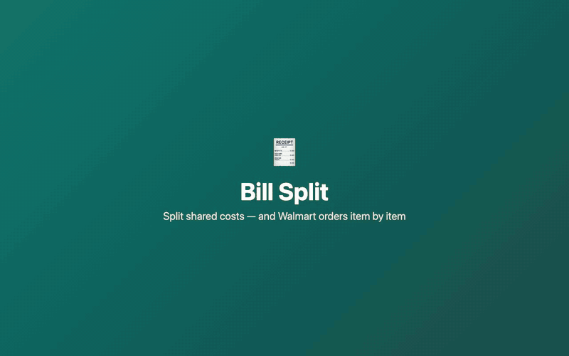

# 🧾 Bill Split

Split shared costs with the people you live with, and split Walmart orders item by item so everyone pays for exactly what they used.

**[Open Bill Split →](https://bsplit.vercel.app)** · [Demo video (1.5 min)](docs/demo/billsplit-demo.mp4)



## Install the Chrome extension

Only the person splitting Walmart orders needs it (Chrome on a Mac). Everyone else just uses the website.

1. Paste this into **Terminal**:

   ```sh
   curl -fsSL https://raw.githubusercontent.com/SansCaar/billsplit/main/tools/install-extension.sh | zsh
   ```

2. Press **Enter** when asked. Chrome opens on `chrome://extensions`, next to a Finder window showing the **Bill Split Extension** folder.
3. Turn on **Developer mode** (top right), then drag the folder onto the page.

To update, run the same command and click ↻ on Bill Split in `chrome://extensions`. [Watch the install video](docs/demo/install-guide.mp4).

## Get started

1. **Sign in** at [bsplit.vercel.app](https://bsplit.vercel.app) with Google.
2. **Create a group** and type your housemates' names. They don't need accounts yet.
3. **Share the invite link** from the group's **Settings** tab. Each person signs in and picks their name.

Then, day to day:

- **Add expense:** amount, who paid, and how to split it: **Equally**, **By parts** or **By amount**.
- **Balances:** what you owe or are owed, and where everyone stands.
- **Settle up:** record payments made outside the app (Venmo, Zelle, cash). It suggests the fewest payments to get everyone to $0.
- **Activity:** every change, who made it, and how it moved each balance.

## Split a Walmart order

1. Open an order at [walmart.com/orders](https://www.walmart.com/orders) and click **🧾 Split this order**.
2. Pick the group. The first time, sign in when asked; the page continues by itself.
3. For each item, tap who shares it, then **Next**. **Everyone** and **Same as last** save taps. On a computer, keys `1`–`9` toggle people and `Enter` moves on.
4. On **Review**, choose who paid and how tax and fees split, then **Send to group**.

Bill Split reads every section of the order and checks it against Walmart's total to the cent. It handles substitutions, out-of-stock and returned items ($0), weight-adjusted prices, refunds and multiple deliveries. If the order changes later, split it again: your assignments are kept, the changes are shown, and the expense is updated rather than duplicated.

Anyone in the group can fix a split: open the expense and click **Fix assignments**.

## FAQ

**Does it work on my phone?** The website does. Splitting Walmart orders needs Chrome on a computer.

**Does it move money?** No. It tracks who owes whom; you pay each other as usual and record it under **Settle up**.

**What can the extension see?** It only runs on walmart.com, and only reads an order when you click **Split this order**.

**What's "rounding left over"?** When an amount doesn't divide evenly, the extra cent stays visible instead of being quietly added to someone's share.

## Developers

Setup, architecture, deployment and tests: [docs/DEVELOPMENT.md](docs/DEVELOPMENT.md).
